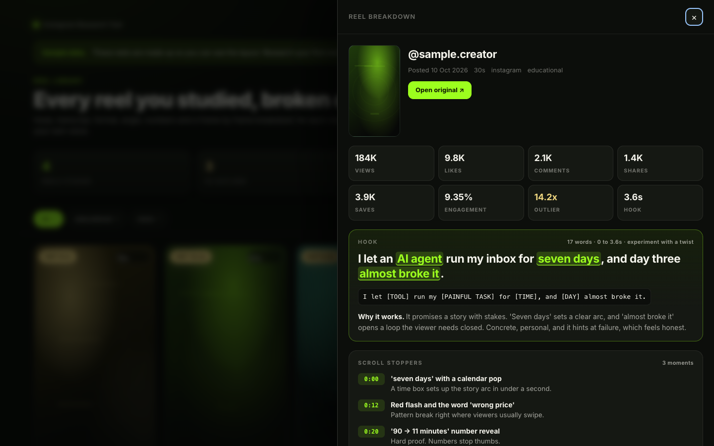
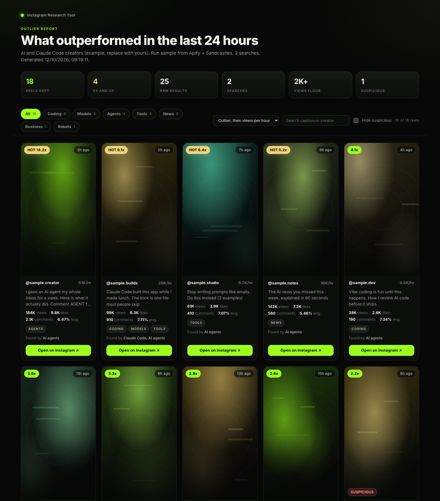

<div align="center">

# 🔎 Instagram Research Tool

### Send any Instagram reel to Claude Code. Get the transcript, the hook, the format and the real numbers. Every morning, see what blew up in your niche.

**Tap Share on a reel → Claude Code breaks it down frame by frame → daily outlier radar → rewrite the idea in your own voice**


**By Manthan Patel ([@LeadGenMan](https://www.youtube.com/@LeadGenMan))**

🔗 [LinkedIn](https://www.linkedin.com/in/leadgenmanthan/) • 📸 [Instagram](https://www.instagram.com/leadgenman/) • 🎥 [YouTube](https://www.youtube.com/@LeadGenMan) • 🎵 [TikTok](https://www.tiktok.com/@leadgenmanthan) • 🎓 [Skool Community](https://www.skool.com/ai-inner-circle/about) • 🎬 [TiltIt](https://tiltit.video)

</div>

---

### 🎓 Join the Community

Get help setting this up, share what your research is turning up, and learn how I make content with AI, with me and 1000s of others inside the **AI Inner Circle**.

> **[👉 Join the AI Inner Circle on Skool](https://www.skool.com/ai-inner-circle/about)**

---

## 🎯 What It Does

Most creators scroll for ideas and forget them by dinner. This kit turns every reel you like into a breakdown you can
learn from, and shows you each morning which reels in your niche are taking off.

1. **Reel research.** Send Claude Code any reel. You get the full transcript, the hook and why it works, the format,
   the angle, the real numbers (views, likes, comments, engagement), and a visual breakdown: Claude watches the video
   frame by frame and points to the exact moments and words that stop the scroll.
2. **Daily outlier radar.** Around 70 searches across your niche, every day. You see which reels outperformed in the
   last 24 hours, ranked, with filters, plus a short read in chat on why the top 10 popped and an idea angle for you.
3. **iPhone share button.** Tap Share on any reel, tap **Save to Research**. The link lands in an inbox, and
   `/reel-research inbox` breaks down everything you saved.
4. **Rewrite in your own voice.** Every breakdown ends with your version: same topic, fresh words, in the voice you
   describe in `voice.md`. Never the creator's lines.

Everything lands in a library you open in your browser:



And the daily outlier report:



*(Screenshots use synthetic sample data.)*

---

## 🔌 Pick Your Data Source

You are not locked in to any tool. A data source only fetches the raw facts (numbers, caption, video). Claude Code does
all the analysis itself, so the breakdown is the same whichever one you pick. Switch any time in `config.json`.

| Source | What it gives you | Cost | Setup |
|---|---|---|---|
| **[Sandcastles](https://sandcastles.ai)** (MCP) | Reel breakdowns with a timed transcript and hook analysis, plus the daily search with real outlier scores. Covers Instagram, TikTok and YouTube Shorts | Paid plan, from $49/month (the MCP needs Pro or higher). Searches are free, each new reel analysis is 1 credit | About 2 minutes |
| **[Apify](https://console.apify.com/sign-up?fpr=f7e9d)** | Reel data plus the video file, and the daily search through hashtags (no outlier score, ranked by views per hour) | Pay per result. $5 free credit every month. Under 1 cent per reel, about $1.70 for a full daily search | About 3 minutes |
| **yt-dlp** | Free, open source, single reels only (public Instagram, TikTok and Shorts links). Transcript via local Whisper. Usually no view count on Instagram, and Instagram may block it. No daily search | Free | 1 minute |
| **Any other source** | Bring your own: a video file, an export from another tool, or numbers you paste | Whatever your source costs | None |

Mix them if you like: yt-dlp for single reels and Apify or Sandcastles for the daily search. Guides:
[Sandcastles](providers/sandcastles.md) • [Apify](providers/apify.md) • [yt-dlp](providers/yt-dlp.md) •
[any other source](providers/any-source.md) • [add your own](providers/README.md)

---

## 🛠️ Tools You'll Need

- 🤖 **[Claude Code](https://claude.com/claude-code)**
- 🟢 **Node.js 18+** (no `npm install`, the kit has zero dependencies)
- 🔌 **One data source** from the table above
- 🎞️ **ffmpeg** (optional, for the frame-by-frame breakdown): `brew install ffmpeg`
- 🗣️ **Whisper** (optional, for transcripts when your source has none): `pipx install openai-whisper`
- 📱 **An iPhone** (optional, for the share button)

---

## 🚀 Quick Start

```bash
# 1. Download the zip, double-click it to unzip
# 2. Open Terminal in the folder:
cd ~/Downloads/instagram-research-tool
claude
```

Then, inside Claude Code:

```
/research-setup
```

The setup asks a few questions, one at a time: which data source you want (and connects it), your niche (it writes
your daily search queries), three of your own captions (it learns your voice), then walks you through the iPhone share
button and runs the self-test. About 10 minutes.

Want to look around first? These run on synthetic samples, no setup needed:

```bash
npm run library          # opens the reel library with a sample breakdown
npm run sample-report    # opens a sample outlier report
npm run selftest         # checks everything works, exit 0 = pass
```

---

## ☀️ Daily Use

| When | Do this | You get |
|---|---|---|
| While scrolling | Share > **Save to Research** on any reel worth studying | The link saved to your inbox |
| Morning | `/outliers` | Today's outlier report opens, plus the top 10 explained in chat |
| Morning | `/reel-research inbox` | Every saved reel broken down and added to your library |
| Any time | `/reel-research <reel link>` | One reel broken down on the spot |
| Before filming | Open `out/library.html`, pick an idea, start from "My version" | A draft in your voice to make your own |

Want the morning part to run by itself? [docs/iphone-shortcut.md](docs/iphone-shortcut.md) shows a cron and a launchd
example for `claude -p "/reel-research inbox"` and `claude -p "/outliers"`.

---

## 📋 What You Get Per Reel

| Section | What's in it |
|---|---|
| Numbers | Views, likes, comments, engagement rate, outlier score (when your source has it), posted date |
| Transcript | Every line with timestamps |
| Hook | The opening line, word count, how long it takes to say, a reusable template, its type, why it works, the power words |
| Format | Category, type, visual layout, pacing (cuts per second), why this format fits the idea |
| Angle | The topic, the specific take, what most people believe, what the reel says instead |
| Visual breakdown | A timeline of every shot: what's on screen, the on-screen text, what each shot does for retention |
| Scroll stoppers | The 2 to 5 moments most likely to stop a thumb, with timestamps |
| My version | A new hook and full script on the same topic, written in your voice |

---

## ⚙️ How It Works

```
Tap Share on a reel (iPhone Shortcut "Save to Research")
    |
    v
iCloud Drive/Reel Research/inbox.txt  ->  syncs to your Mac
    |
    v
/reel-research inbox  (or /reel-research <link>)
    |   your data source: Sandcastles MCP, Apify, yt-dlp, or your own file
    v
numbers + caption + video  ->  transcript (from the source, or local Whisper)
    |
    v
frames.mjs cuts contact sheets  ->  Claude looks at every frame
    |
    v
hook + why it works, format, angle, visual breakdown, scroll stoppers, your version
    |
    v
library/reels/<id>.json  ->  out/library.html
```

```
/outliers
    |   ~70 searches from niche.json (Sandcastles MCP or Apify)
    v
data/raw/search-<stamp>/  ->  outliers.mjs
    |   last 24 hours (48 only if the day is thin), 2,000+ views, duplicates merged,
    |   tagged by topic, suspicious reach flagged, ranked by outlier score
    v
reports/<stamp>.html  +  the top 10 explained in chat, with an idea angle for you
```

---

## 📁 Folder Structure

```
instagram-research-tool/
├── CLAUDE.md                    # how Claude Code runs the kit, read first every session
├── README.md                    # this file
├── LICENSE                      # MIT
├── config.json                  # your data source and run settings
├── niche.json                   # your daily search queries, grouped in clusters
├── voice.md                     # how you talk, used for every "my version" rewrite
├── .env.example                 # copy to .env for an Apify token (never committed)
├── package.json                 # npm run selftest / library / outliers / inbox / sample-report
├── .claude/
│   └── skills/
│       ├── reel-research/       # /reel-research <link...> | /reel-research inbox
│       ├── outliers/            # /outliers [--48h]
│       └── research-setup/      # /research-setup, the first-run wizard
├── providers/
│   ├── README.md                # the provider contract + how to add your own
│   ├── sandcastles.md           # MCP setup, tools, credits, field mapping
│   ├── apify.md                 # token setup, actors, costs, field mapping
│   ├── yt-dlp.md                # free single reels, limits, safe use
│   └── any-source.md            # video files, your own exports, pasted numbers
├── scripts/
│   ├── apify-reel.mjs           # one reel through Apify
│   ├── apify-search.mjs         # the daily search through Apify
│   ├── ytdlp-reel.mjs           # one reel through yt-dlp
│   ├── normalize.mjs            # any raw source -> the kit's format, plus --validate
│   ├── transcribe.mjs           # local Whisper transcript
│   ├── frames.mjs               # ffmpeg contact sheets for the visual breakdown
│   ├── inbox.mjs                # new links from the iPhone inbox
│   ├── outliers.mjs             # merge, filter, rank, build the report
│   ├── build-library.mjs        # build out/library.html
│   ├── selftest.mjs             # offline checks on the samples
│   └── lib/                     # shared helpers
├── docs/
│   ├── iphone-shortcut.md       # build the share button + optional daily automation
│   ├── schema.md                # every field in a breakdown and a report
│   └── screenshots/
├── samples/                     # synthetic sample data (no real creators)
├── library/reels/               # your breakdowns, one JSON per reel
├── reports/                     # your outlier reports
├── data/raw/                    # raw source data, kept for re-parsing
├── media/                       # videos, covers, transcripts, frames (not committed)
└── out/                         # library.html (not committed)
```

---

## 🎛️ Settings

`config.json`:

| Field | Default | What it does |
|---|---|---|
| `provider` | `sandcastles` | Single-reel source: `sandcastles`, `apify`, `ytdlp` or `any` |
| `searchProvider` | `sandcastles` | Daily search source: `sandcastles` or `apify` |
| `inboxPath` | `~/Library/Mobile Documents/com~apple~CloudDocs/Reel Research/inbox.txt` | Where the iPhone Shortcut's file syncs on your Mac |
| `windowHours` | `24` | The outlier window |
| `maxWindowHours` | `48` | The ceiling. The window only widens when fewer than 15 reels qualify, and never past this |
| `minViews` | `2000` | Reels under this are left out of reports |
| `transcription` | `auto` | Use the source's transcript when it has one, otherwise local Whisper |
| `myHandle` | `""` | Your Instagram handle (optional) |

`niche.json` holds your search queries in clusters (the example is the AI and Claude Code niche). `/research-setup`
rewrites it for your niche, or edit it by hand: write queries the way creators caption reels.

---

## ✍️ Keep It Original

This is a research tool, not a copy machine.

- **Use the idea, write your own words.** Topics, angles and formats are fair game. Someone's script is not. "My
  version" never reuses the creator's lines, jokes or stories, and Claude checks for copied phrases before saving.
- **Never repost other people's content.** Don't re-upload their video, their caption, their cover or their artwork.
  The videos the kit downloads stay on your computer for analysis only.
- **Add what only you have.** Your results, your products, your story. That's what makes the video yours.

---

## ❓ FAQ

**Do I need to code?**
No. You talk to Claude Code in plain English and it runs everything. `/research-setup` does the setup with you.

**Is it against Instagram's rules?**
The kit never logs in to Instagram, never uses your cookies or session, and never scrapes with your account. Your
account is not involved at all. Data comes only from the source you choose: Sandcastles is a licensed research
platform, Apify collects public data on its own side, and yt-dlp reads public pages without an account (use it
lightly, and never give it your cookies). Then use the ideas, never repost the content.

**What does it cost?**
The kit is free (MIT). You need Claude Code. Then your data source: yt-dlp is free, Apify gives you $5 of free credit
every month (under 1 cent per reel, about $1.70 for a full daily search), and Sandcastles starts at $49/month for a plan
with the MCP (searches are free, each new reel analysis is 1 credit).

**Does it work for my niche?**
Yes. The example `niche.json` is AI and Claude Code because that's my niche. `/research-setup` asks about yours and
writes your queries. Fitness, food, finance, real estate, anything with reels.

**What about TikTok and YouTube Shorts?**
Sandcastles covers both for reel breakdowns and for the daily search. yt-dlp handles public TikTok and Shorts links for
single breakdowns. The Apify actors in this kit are Instagram only.

**Do I need an iPhone or a Mac?**
Only for the share button. The kit runs on macOS and Linux. Without an iPhone, paste links into `/reel-research`, or
point `inboxPath` at any text file that syncs to your computer.

**What if a number is missing?**
It stays empty. The kit never makes numbers up. yt-dlp, for example, usually doesn't return Instagram view counts, so
those show as unknown.

**Where does my data go?**
Nowhere. Everything is saved in this folder on your computer. The only outside calls are to the data source you picked.

---

## 📄 License

MIT. See [LICENSE](LICENSE).

---

<div align="center">

**By [Manthan Patel](https://www.instagram.com/leadgenman/)**

⭐ Star this repo if it found you your next viral idea.

Questions, results, or your own setup: bring them to the [AI Inner Circle](https://www.skool.com/ai-inner-circle/about).

</div>
